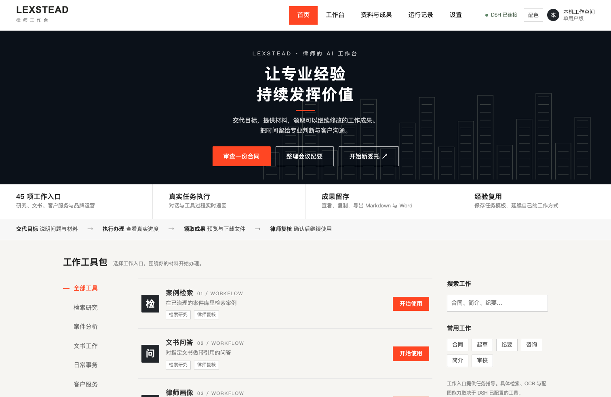

# Lexstead 律师 AI 工作台

**在 DeepSeek Harness 客户端中使用的中文律师工作前端。macOS 源码预览版。**



把合同审查、文书起草、会议纪要、客户服务、律师品牌等工作入口放到同一个工作台中，连接 DSH 的真实会话、工具执行与生成文件。

本项目是独立的社区前端，不是 DeepSeek 官方产品。首版适配 **DSH `0.1.6-alpha.2`**，已经在 macOS / Node.js 24 / Chrome 安装的 DSH 应用窗口验证。新版 DSH、官方 Electron 客户端、Windows 和 Linux 尚未完成目标环境验收。

## 下载与安装

在本仓库点击 **Code → Download ZIP**，解压后保留整个目录。也可以使用 Git：

```sh
git clone https://github.com/youngzhen78/lexstead-dsh-workbench.git
cd lexstead-dsh-workbench
```

先从 [Node.js 官网](https://nodejs.org/)安装 **Node.js 24 或更新版本**，然后在终端执行：

```sh
npm ci
npm run setup
npm start
```

macOS 也可在解压目录运行 **安装并启动.command**；后续运行 **启动.command**。如果 ZIP 解压后没有执行权限，可先执行：

```sh
chmod +x *.command
```

`setup` 会从官方 npm 包安装固定版本的 DSH 到本项目的私有 `.runtime` 目录，并在当前用户的 DSH web profile 中安装客户端插件。模型 API Key、计费账号和供应商配置需要使用者自己在 DSH 中设置；代码不附带任何密钥。首次启动可能需要几分钟安装依赖。

如未安装 DSH 应用窗口，启动器先打开浏览器；可以通过 Chrome 的“安装应用 / 将网页作为应用安装”把工作台作为独立窗口使用。已有 Chrome 安装的 DeepSeek Harness 应用时，会优先打开该窗口。**这不是签名的独立 `.app` / `.dmg` 安装包。**

Word 导出需要另装 [Pandoc](https://pandoc.org/installing.html)。macOS Homebrew 用户可运行 `brew install pandoc`；没有 Pandoc 时仍可复制和导出 Markdown。

## 已经有 DSH 的用户

不重复安装 DSH，指定现有源码目录及启动日志：

```sh
npm ci
npm run setup -- --dsh-root /path/to/deepseek-harness --dsh-log /path/to/dsh-server.log
npm start
```

已有源码需要完成其官方构建步骤。启动日志中应有本机 DSH 正常输出的登录 URL；程序只在本机读取，不把登录令牌、模型密钥或日志上传到 GitHub。

不要把登录令牌粘贴到公开 Issue。调试配置可查看 `config.local.json`，但该文件也不应上传。

默认沿用 `~/.dsh`，因此现有会话与模型设置可以继续使用。安装前会备份原 `profiles/web/cordis.patch.yml`，只增加 Lexstead 插件，保留其他配置项。如希望独立使用，可加 `--dsh-home /path/to/another-dsh-home`；新的 home 需要重新配置模型。

## 使用

1. 首页选择工作入口，或创建新委托。
2. 上传材料，说明立场、背景和期望成果，点击“委派办理”。
3. 在中间查看真实回复和工具过程，在右侧打开成果。
4. 复制、下载，或导出 Markdown / Word；导出副本保存在本项目 `workspace/对应委托/导出成果/`。
5. 通过“设置 → 打开 DSH 管理界面”配置模型、插件与原有工作区，再点击“返回律师工作台”。

当前提供 **45 项任务指导入口**，不表示附带 45 个专用 Skill、数据库授权或自动化工作流。法律检索、OCR、配图等取决于 DSH 实际安装的工具。原型中的示例人名、案号和场景仅用于说明，请替换为自己的材料。

## 本地数据和运行边界

- 只监听 `127.0.0.1`。默认 DSH 端口 `3080`，产品服务端口 `3088`，客户端入口为 `/lexstead/`。
- 本机运行不等于离线推理。使用云端模型时，输入和工具结果会按 DSH 配置发送给模型供应商。
- 当前是单用户工作空间；未提供企业身份、案件级隔离、团队审批、自动脱敏或向量知识库治理。
- DSH 保存会话正文；本项目 `.state` 保存委托索引、模板与本机复核记录。`workspace` 保存文件。请按需要备份这些本机数据。
- 复核按钮是使用者的工作记录，不代表自动法律合规认证。专业成果仍应由律师复核。

公开源码不包含开发者的工作文件、历史会话、模型密钥、启动日志或个人路径。

## 维护与卸载

```sh
npm run doctor     # 检查环境，不显示凭据
npm test           # 本地协议夹具测试，不调用付费模型
npm run uninstall # 移除客户端插件，刷新 DSH 恢复原首页
npm run stop      # 关闭产品服务；先关闭客户端窗口，避免按需重启
```

卸载保留数据和备份，不删除 DSH 会话或模型配置。单独停止产品服务也不停止 DSH。

如 `3080` 已被其他 DSH 实例占用，应通过 `--dsh-log` 连接该实例；不要让多个不同配置的 DSH 争用同一端口。可通过 `DSH_ORIGIN`、`PORT`、`PANDOC`、`DSH_HOME` 等环境变量调整部署。修改端口后重新运行 `setup` 更新客户端插件。

## 项目结构

为便于直接下载和分发，首版使用扁平目录：`app.js` / `app.css` / `index.html` 为界面，`server.mjs` 为产品服务，`dsh.mjs` 为会话协议适配，`client-plugin.mjs` 为 DSH 客户端集成，`cli.mjs` 为安装与生命周期入口。

源码预览版的兼容与验证范围见 [RELEASE_NOTES.md](RELEASE_NOTES.md)。欢迎提交不含客户数据或凭据的 Issue / PR。

## 许可证

MIT，见 [LICENSE](LICENSE)。DSH 和第三方依赖遵循其各自许可证，见 [THIRD_PARTY_NOTICES.md](THIRD_PARTY_NOTICES.md)。
